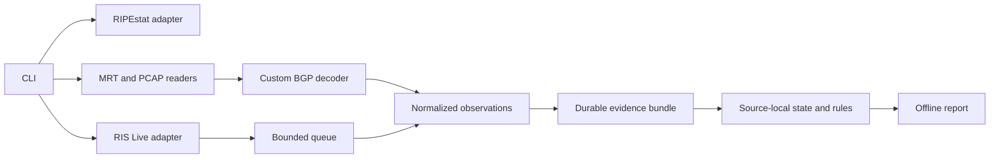
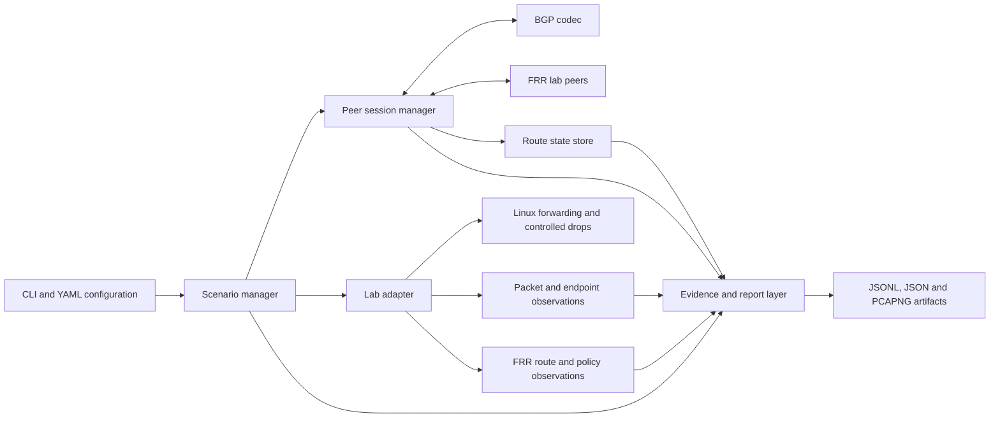
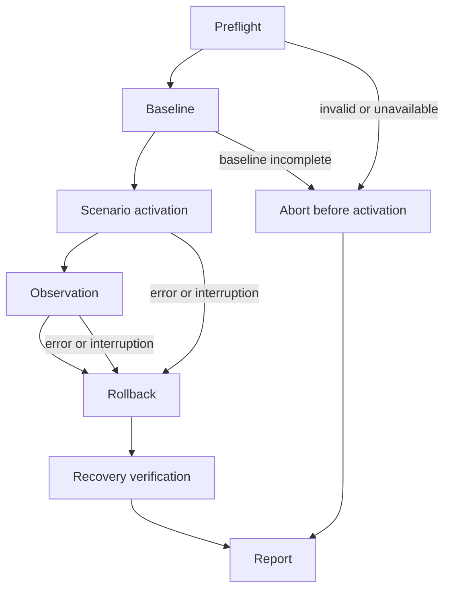

# Architecture

**Passive-analysis scope update:** AN03–AN07 now provides lab-independent lookup, file inspection, RIS Live recording, and offline change reports. See [Passive analysis](passive-analysis.md) for implemented commands, schema, bounds, and limitations. The active lab requirements below remain deferred; M1–M4 are not closed by passive analysis.

**Status: passive architecture implemented; active architecture deferred.** Shared models, static validation, pure evaluation, CLI scaffolding, control-message codecs and durable journals are implemented. A minimal developer lab tool is available. The session engine, scenario lab adapter, active route store and live packet observation components remain planned; the [development guide](development.md) describes current boundaries.

## Implemented passive path

`bgp-hijack-analysis` owns these adapters, passive state, and reporting. The existing lab
configuration/evidence schema remains separate. Sources and epochs prevent combining unrelated
paths; recording and replay use the same rule engine. The architecture below describes deferred
active experiments.

## Deferred active component boundaries

The custom engine uses Rust. Tokio will provide asynchronous I/O and timers, Clap defines the CLI, and Serde handles configuration and artifact serialization. The workspace pins dependency/toolchain versions; runtime metadata will identify the versions used for each experiment.

| Component | Owns | Boundary |
| --- | --- | --- |
| BGP codec | Bounded framing, decoding, encoding, and structured protocol errors. | Does not access sockets or alter lab routing. |
| Peer session manager | TCP connection lifecycle, capabilities, FSM, timers, and ordered peer events. | Does not decide scenario success. |
| Route state store | Peer-specific route observations, withdrawals, epochs, and snapshots. | Does not equate a local observation with a remote forwarding decision. |
| Scenario manager | Preflight, baseline, bounded execution, expectations, rollback, and recovery. | Uses named fixtures and the declared lab inventory. |
| Evidence and report layer | Event journal, artifact integrity, assertion evaluation, and offline reporting. | Does not infer success from missing observations. |

The lab adapter will be an internal dependency of the scenario manager. It will address declared Containerlab nodes and interfaces, collect FRR snapshots, and apply only fixture-defined changes. The packet observer will record selected experiment traffic. Neither is an alternate general-purpose BGP implementation.

## Control and data planes

The Rust engine will originate fixture-defined lab announcements and observe configured peers. It will not automatically redistribute all learned routes or claim to reproduce a peer's best-path decision. Remote route and policy snapshots will be collected separately from the engine's received-route store.

Linux will perform forwarding and controlled packet drops inside lab namespaces. The scenario manager will coordinate these actions rather than implement a new TCP/IP stack. Forwarding paths must be established before a scenario is activated and remain available while its routing changes are rolled back.

Packet captures, endpoint probe results, and peer observations will share a run identifier. Correlation will use explicit flow identifiers and recorded observation intervals. A BGP AS path, a TTL trace, and the actual packet observations are different evidence types; none will silently substitute for another.

## State and concurrency

Each peer will have one owning session task. Socket reads, FSM changes, timers, and the emission of that peer's route events will be serialized by that owner. A session epoch will change whenever a fresh connection is established, preventing late work from an old connection from reviving removed routes.

Route identity will include the lab, peer, address family, and canonical prefix. Epoch metadata will identify the connection that supplied it. Without ADD-PATH, the store will retain one current path per peer/family/prefix and multiple paths across different peers. It will preserve AS-path segment structure rather than flatten all paths into an untyped ASN list.

A single route-state owner will apply ordered events and publish immutable snapshots. Encoding, capture writing, and offline analysis may execute concurrently, but processing a later withdrawal before an earlier announcement for the same session is not permitted. BGP messages that affect several prefixes will be applied as one ordered update batch.

Inter-component queues will be bounded. Route and control events will never be silently discarded. Saturation will emit a diagnostic when possible and trigger a controlled run abort before memory grows without bound. Capture loss or an exceeded recording limit will be recorded as an evidence gap; it must not be hidden by an otherwise healthy BGP session.

UTC timestamps will support human correlation. Monotonic elapsed time will drive deadlines and durations. An artifact sequence number will identify journal order, not imply that clocks on different nodes are synchronized.

## Lifecycle and recovery

Before each mutation, the scenario manager will journal intent, the affected lab resource, and the recovery action. Afterward it will record the observed result. Recovery actions will be idempotent and scoped to resources owned by the run. Cleanup will use its own bounded deadline so cancellation of the main task does not immediately cancel rollback.

Normal completion, SIGINT, SIGTERM, a peer failure, and an active-run deadline will enter rollback. The manager will withdraw experiment announcements or close the relevant sessions, verify their removal at peers, and then restore forwarding/drop state. A pre-existing route that was changed by the experiment will be restored, rather than indiscriminately deleting a prefix.

A killed process cannot execute cleanup. Its unfinished journal will therefore block a new run in the same lab until the lab has been reset and a fresh preflight proves the baseline. Session expiry is useful recovery behavior, but is not itself proof that all lab state has recovered. A partially written journal will remain available for an inconclusive offline report.

Only one active run per lab will be supported in the first release. Lock acquisition and release will be associated with the run identifier; a stale lock will not be treated as permission to reuse uncertain network state.

## Evidence and result evaluation

Observations will enter an append-only JSONL journal. A shared evaluator will produce both the live command's report and an offline regenerated report. It will consume explicit assertions, evidence references, and evidence-gap events.

The evaluator will retain separate scenario and recovery results. A proven failed assertion will make the overall result `failed`. Otherwise, an unresolved assertion, interruption, or incomplete required evidence will make it `inconclusive`. Only a fully observed normal run with successful recovery will be `passed`.

## Runtime boundary

Preflight will verify actual namespaces, interfaces, neighbor inventory, and isolation, rather than trusting YAML declarations alone. The engine and capture operations will be bound to lab interfaces. Host networking, external peer endpoints, and forwarding between the management network and experiment links will be unsupported.

Capture and network administration will use only the privileges required for the declared lab resources. Parsing, configuration inspection, and offline reports will not require network-administration privileges. Reports will record software versions, fixture identity, effective configuration, capture completeness, and the scope of observations.

See [Lab and scenarios](lab-and-scenarios.md) for the topology and [Interfaces](interfaces.md) for the artifact contract.
