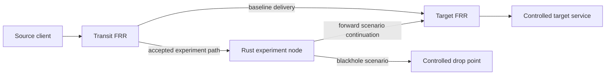

# Reference lab and scenarios

**Status: full scenario topology planned.** The five-role topology and scenarios below remain design fixtures. Sprint 2 adds a separate two-node peer fixture and explicit developer lifecycle tools; see the [development guide](development.md#minimal-frr-fixture). That fixture does not implement these traffic scenarios, and its live verification status is recorded separately in the sprint plan.

## Reference environment

The reference lab will run on Linux using Docker and Containerlab. FRR will supply independent routing peers, while the experiment node will run the custom Rust BGP engine. Images and topology versions will be pinned for each validated release. Containerlab documents its [FRR integration](https://containerlab.dev/manual/kinds/frr/).

| Role | Fixture node | Responsibility |
| --- | --- | --- |
| Source | `client` | Send bounded synthetic probes and record responses. |
| Transit | `transit` | Apply the selected prefix-policy fixture and expose route/policy observations. |
| Target router | `target-router` | Provide baseline reachability to the controlled target. |
| Target | `target` | Run the test service and record received probes. |
| Experiment | `experiment` | Run the Rust engine and the controlled forwarding/drop behavior. |

This diagram shows logical forward paths. The fixture will also define return reachability. The continuation from the experiment node to the target will be independent of the changed transit route, preventing the forwarded packets from looping back into the experiment path. Management connectivity is omitted from the traffic diagram and must remain separate.

## Isolation and inventory

Containerlab's default management network connects nodes to a host-side network; it is not sufficient evidence of an isolated experiment. The fixture will explicitly prevent forwarding between management and experiment interfaces and prevent external egress from experiment links. See the [Containerlab network model](https://containerlab.dev/manual/network/).

Preflight will verify:

- Node and interface identities against the declared lab inventory, including namespace ownership.
- Lab-only peer endpoints and the absence of host networking, external links, or external route-export paths.
- Effective IPv4 and IPv6 routing and isolation rules, rather than configuration declarations alone.
- Availability of required privileges, capture points, peer observations, storage, and the selected policy fixture.
- Exclusive ownership of the lab by this run and the absence of unresolved prior-run state.

Failed or unverifiable isolation checks will stop activation. Prefix/ASN restrictions alone will not count as isolation. Image fetching and dependency installation belong to environment preparation, before an experiment is active.

Reference examples will use IPv4 documentation space such as `192.0.2.0/24`, IPv6 documentation space such as `2001:db8:100::/48`, and private-use ASNs, including four-octet values. These assignments are described in [RFC 5737](https://www.rfc-editor.org/rfc/rfc5737.html), [RFC 3849](https://www.rfc-editor.org/rfc/rfc3849.html), and [RFC 6996](https://www.rfc-editor.org/rfc/rfc6996.html). They must remain inside the closed test topology.

## Shared experiment lifecycle

| Phase | Required observations and actions | Failure behavior |
| --- | --- | --- |
| Preflight | Verify topology, isolation, configuration, ownership, and observation readiness. | Stop before activation; explain the failed requirement. |
| Baseline | Establish required sessions; record expected routes, peer policy, endpoint delivery, and capture readiness. | Skip activation if the baseline is incomplete. |
| Scenario | Apply the named fixture's bounded route and forwarding/drop changes, with journaled recovery actions. | Enter rollback after any partial activation failure. |
| Observation | Collect peer routing/policy evidence, source/experiment/target packet evidence, and endpoint results. | Record evidence gaps; enter rollback at the deadline or on error. |
| Rollback | Remove experiment route changes, verify removal, and restore experiment-owned data-plane state. | Preserve diagnostics and continue other independent cleanup actions. |
| Recovery | Check restored routing and fresh endpoint probes against the baseline. | Report failed or unverified recovery explicitly. |

Tests will use identifiable, bounded probe sequences. Probe frequency, packet count, observation windows, and capture size will be recorded; the fixture will not generate saturation traffic. Capture on the experiment node's management interface is outside the capture scope.

The `accept` and `reject` profiles will differ only in the relevant prefix-filter policy. `accept` must make the fixture's experiment route eligible and selected under its declared local policy; acceptance alone does not universally imply selection. `reject` must exclude the experiment route while preserving baseline reachability.

## Forward scenario

Under `accept`, test traffic will traverse the experiment node and reach the original target. The target's identity and test-service response will remain the baseline ones. Proof will combine the transit's selected route, matching flow observations at source/experiment/target, and responses received by the source.

Both request and response directions will be measured. The fixture will declare the intended return path, so asymmetric return traffic is neither silently missed nor automatically treated as failure. A TTL change or a TCP fingerprint will not substitute for matching flow evidence. No TLS decryption claim will be made.

Under `reject`, peer evidence will show that the relevant update was received and rejected by the selected policy. Baseline delivery will continue, and selected test traffic must not traverse the experiment data interface. A working endpoint without evidence of the peer's rejection is insufficient to pass the policy assertion.

## Blackhole scenario

Under `accept`, selected test probes will reach the experiment node's controlled drop point and fail to reach the target. Proof will include source transmission, experiment ingress, the scoped drop counter/action, target-side capture completeness, and missing target delivery for the identified probes. A separate lab-local health observation will confirm that the target service itself remains available.

This is an intentional drop experiment. A silent endpoint, missing capture, or saturated interface does not independently prove a blackhole. Management access and unrelated baseline control traffic will remain usable.

Under `reject`, the peer's filter will reject the experiment route and the selected probes will continue reaching the target over the baseline path. Matching drop counters for the selected flow must remain unchanged.

## Acceptance matrix

Every row is an independent run. Both families will also be exercised together to detect family-state interference.

| ID | Scenario | Family | Policy | Expected traffic during observation |
| --- | --- | --- | --- | --- |
| F4A | `forward` | IPv4 | `accept` | Source -> experiment -> target; valid response reaches source. |
| F4R | `forward` | IPv4 | `reject` | Baseline delivery; no selected-flow traversal of experiment. |
| F6A | `forward` | IPv6 | `accept` | Source -> experiment -> target; valid response reaches source. |
| F6R | `forward` | IPv6 | `reject` | Baseline delivery; no selected-flow traversal of experiment. |
| B4A | `blackhole` | IPv4 | `accept` | Selected probes reach experiment and are verifiably dropped. |
| B4R | `blackhole` | IPv4 | `reject` | Baseline delivery; no matching experiment drops. |
| B6A | `blackhole` | IPv6 | `accept` | Selected probes reach experiment and are verifiably dropped. |
| B6R | `blackhole` | IPv6 | `reject` | Baseline delivery; no matching experiment drops. |

Each row additionally requires the expected control-plane evidence, healthy observation points, and verified recovery. A `reject` profile passing its assertions is a successful defensive test, not an unsuccessful attack verdict.

## Time windows, gaps, and recovery

The scenario will have separate convergence, observation, and recovery windows. Before convergence is observed, transitional packets will be labeled as such and excluded from steady-state delivery assertions. Failure to converge before the configured deadline will be a failed timing assertion only when complete evidence proves non-convergence; otherwise it will be inconclusive.

Once the observation window starts, every scheduled probe must have an accounted-for outcome. Missing or dropped capture data will invalidate assertions that depend on it. Proven failures elsewhere will remain failures even if another assertion is inconclusive.

Rollback will happen after normal completion, timeout, cancellation, or peer failure. Recovery success requires removal of the experiment routes/effects and fresh successful baseline probes. Loss of observability during cleanup will produce `unverified` cleanup and prevent a passing result.

After a crash that bypasses cleanup, the operator will reset the isolated lab through its lifecycle tooling. A new run must pass preflight and baseline again. An unfinished journal must not be overwritten or treated as a completed recovery.

See [Interfaces](interfaces.md) for result fields and [Roadmap and validation](roadmap-and-validation.md) for fault-injection tests.
